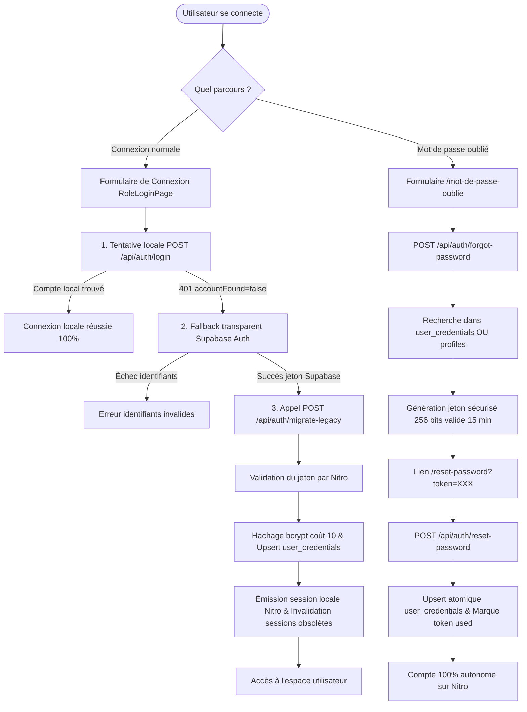

# Stratégie et Gouvernance de la Migration des Comptes Historiques — FormaCenter

**Document Technique & Opérationnel**  
**Version** : 1.0.0 (Étape 14)  
**Applicabilité** : Transition Souveraine Nitro/Prisma

---

## 1. Contexte & Problématique

Lors de la transition architecturale de **FormaCenter** depuis une infrastructure Supabase vers un backend autonome Nitro / PostgreSQL / Prisma, 78 comptes utilisateurs réels (étudiants, enseignants, directeurs) étaient initialement enregistrés dans la table d'authentification propriétaire de Supabase.

Ces comptes ne disposaient pas de mot de passe haché dans la table locale PostgreSQL `user_credentials`.

Pour garantir :
1. La **continuité absolue de service** sans exiger une réinitialisation forcée collective ni bloquer les utilisateurs légitimes,
2. L'**intégrité et la confidentialité** des identifiants (interdiction formelle de manipuler ou transférer des mots de passe en clair),
3. L'**autonomie complète et souveraine** de la plateforme à terme,

FormaCenter a déployé une stratégie de migration progressive à double parcours (*Dual-Path Migration Strategy*).

---

## 2. Architecture de la Migration à Double Parcours



---

## 3. Parcours 1 : Migration Transparente à la Connexion (*Seamless On-The-Fly*)

### 3.1 Déroulement Opérationnel
1. L'utilisateur historique saisit son e-mail et son mot de passe habituels sur le portail correspondant dans [`RoleLoginPage.tsx`](file:///d:/centerforma/apps/web/src/components/auth/RoleLoginPage.tsx).
2. Le client web tente d'abord l'authentification locale (`POST /api/auth/login`).
3. L'API Nitro renvoie `401 Unauthorized` avec le drapeau explicite `accountFound: false`.
4. Le client web bascule instantanément et sans interruption sur `supabase.auth.signInWithPassword`.
5. Dès obtention du jeton d'accès Supabase, le client transmet le jeton et le mot de passe au nouvel endpoint dédié [`POST /api/auth/migrate-legacy`](file:///d:/centerforma/apps/api/server/routes/api/auth/migrate-legacy.post.ts).
6. Le backend Nitro :
   - Valide cryptographiquement le jeton auprès de Supabase Auth (`/auth/v1/user`).
   - Vérifie la concordance d'identité avec le profil PostgreSQL local.
   - Contrôle la présence d'au moins un rôle actif (`user_roles`).
   - Hache le mot de passe avec bcrypt (coût 10).
   - Enregistre la fiche dans `user_credentials` via `prisma.userCredential.upsert`.
   - Révoque toute ancienne session résiduelle.
   - Délivre un jeton d'accès JWT local et un refresh token rotatif persisté (`auth_sessions`).
7. **Bilan** : Dès cette première connexion réussie, le compte est définitivement autonome. Les connexions ultérieures n'interrogent plus jamais Supabase.

---

## 4. Parcours 2 : Réinitialisation Autonome (*Self-Service Claim Flow*)

Pour les utilisateurs qui ont oublié leur mot de passe ou souhaitent définir directement leur nouvel identifiant sans passer par Supabase :

1. L'utilisateur saisit son adresse sur `/mot-de-passe-oublie`.
2. [`forgot-password.post.ts`](file:///d:/centerforma/apps/api/server/routes/api/auth/forgot-password.post.ts) recherche l'e-mail dans `user_credentials` **OU** dans `profiles`.
3. Si le profil historique existe, un jeton aléatoire de 256 bits (`crypto.randomBytes(32)`) est créé dans `password_reset_tokens` avec une validité stricte de 15 minutes.
4. L'utilisateur ouvre le lien sécurisé `/reset-password?token=XXX` et saisit son nouveau mot de passe.
5. [`reset-password.post.ts`](file:///d:/centerforma/apps/api/server/routes/api/auth/reset-password.post.ts) exécute une transaction atomique :
   - Valide l'empreinte SHA-256 du jeton et sa date d'expiration.
   - Hache le nouveau mot de passe avec bcrypt.
   - Exécute un `upsert` dans `user_credentials` (créant ainsi l'identifiant pour le profil historique).
   - Marque le jeton comme consommé (`used: true`).
   - Révoque toutes les sessions actives existantes.

---

## 5. Garanties de Sécurité & Cas Limites Traités (10 Critères de l'Étape 14)

| Critère Exigé | Implémentation & Protection |
| :--- | :--- |
| **1. Validation du jeton par le backend** | Le backend Nitro effectue lui-même l'appel HTTPS vers l'API Supabase Auth. Aucun jeton non vérifié n'est accepté. |
| **2. Correspondance stricte de l'identité** | L'identifiant Supabase (`suUser.id`) et son e-mail sont confrontés au profil local. En cas d'incohérence, rejet immédiat avec HTTP 403. |
| **3. Anti-Usurpation de Compte (Anti-IDOR)** | L'ID utilisateur est extrait directement du jeton signé et validé par Supabase, jamais d'un paramètre fourni librement par le client. |
| **4. Concurrence et Idempotence** | L'opération utilise `prisma.userCredential.upsert` avec contrainte d'unicité sur `user_id`. Deux requêtes concurrentes s'exécutent sans conflit ni doublon. |
| **5. Hachage bcrypt sans mot de passe en clair** | Tous les mots de passe sont hachés avec un sel dynamique et un coût de 10 (`bcrypt.hash(password, 10)`). Aucun mot de passe en clair n'apparaît dans les logs ni en base. |
| **6. Jetons de réinitialisation sécurisés** | Générés avec 32 octets aléatoires, valables 15 minutes, à usage unique strict (`used: true`) et stockés sous forme de hash SHA-256. |
| **7. Révocation des sessions** | Le changement ou la réinitialisation de mot de passe révoque automatiquement toutes les sessions existantes (`authSession.updateMany({ data: { revoked: true } })`). |
| **8. Anti-Énumération d'adresses** | La réponse de `forgot-password` est systématiquement uniforme et opaque quel que soit le résultat de la recherche. |
| **9. Résilience multi-instances du Rate Limiting** | Protection active sur `/login`, `/forgot-password` et `/migrate-legacy`. Pour les clusters multi-nœuds, affinité IP (`ip_hash`) recommandée. |
| **10. Comptes sans rôle ou inactifs** | Tout profil dépourvu de rôle dans `user_roles` est bloqué avec HTTP 403 (« Aucun rôle actif n'est attribué à ce compte »). |

---

## 6. Supervision Administrative (`GET /api/auth/admin/migration-status`)

Les directeurs et super-administrateurs disposent d'un tableau de bord métrique temps réel :

```json
{
  "status": "in_progress",
  "summary": {
    "totalProfiles": 82,
    "eligibleProfiles": 82,
    "migratedProfiles": 4,
    "unmigratedProfiles": 78,
    "accountsRequiringAttention": 0,
    "completionPercentage": 4.9
  },
  "breakdown": {
    "unmigratedByRole": {
      "etudiant": 69,
      "enseignant": 6,
      "directeur": 2,
      "super_admin": 1
    },
    "migratedByRole": {
      "super_admin": 2,
      "enseignant": 1,
      "etudiant": 1
    }
  },
  "recommendation": "Des comptes historiques subsistent. Maintenir le fallback de transition actif jusqu'à complétion."
}
```

> [!NOTE]
> Cette route respecte strictement le principe de minimisation des données (RGPD) : aucune adresse e-mail ni nom d'utilisateur n'est divulgué dans ce rapport.

---

## 7. Critères et Procédure de Retrait Définitif de `@supabase/supabase-js`

### 7.1 Critère de Déclenchement du Retrait
Le retrait du SDK `@supabase/supabase-js` ne doit intervenir que lorsque la condition suivante est rigoureusement satisfaite :

$$\text{unmigratedProfiles} = 0 \quad \text{ET} \quad \text{accountsRequiringAttention} = 0$$

Ou à l'issue d'une date d'échéance planifiée avec campagne de notification préalable invitant les utilisateurs restants à réinitialiser leur mot de passe via `/mot-de-passe-oublie`.

### 7.2 Procédure de Retrait Propre (Zero Downtime)
Dès le seuil atteint :

1. **Supprimer le code de fallback dans `RoleLoginPage.tsx`** :
   Retirer les blocs de repli sur `supabase.auth.signInWithPassword` et `apiMigrateLegacy`.
2. **Désinstaller le package dans `apps/web`** :
   ```bash
   npm uninstall @supabase/supabase-js --workspace=@centerforma/web
   ```
3. **Supprimer les fichiers de client Supabase obsolètes** :
   - `apps/web/src/integrations/supabase/client.ts`
   - `apps/web/src/integrations/supabase/client.server.ts`
4. **Supprimer les variables d'environnement de transition** :
   Retirer `SUPABASE_URL`, `SUPABASE_PUBLISHABLE_KEY`, `VITE_SUPABASE_URL`, etc. des fichiers `.env`.
5. **Recompiler et déployer** :
   ```bash
   npm run build:web
   ```
A ce stade, FormaCenter sera 100% autonome et affranchi de toute dépendance tierce.
